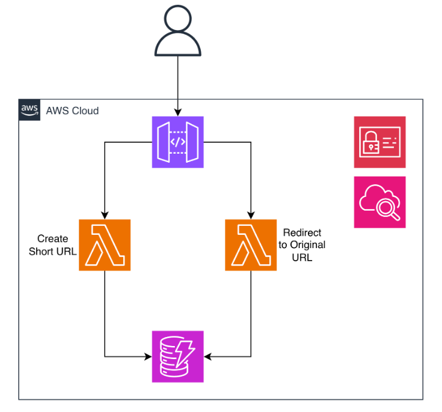

# 🔗 Serverless URL Shortener on AWS

A serverless URL Shortener built using **Amazon API Gateway, AWS Lambda, Amazon DynamoDB, IAM, and CloudWatch**.

The application provides REST APIs for creating short URLs and redirecting users to their original destinations. URL mappings are stored in DynamoDB, while Lambda functions handle URL creation and redirection.

> **Project Status:** The AWS resources used for the original deployment were removed after development and testing to avoid ongoing cloud infrastructure costs. The source code, architecture, configuration details, testing results, and screenshots from the actual AWS implementation are preserved in this repository.

---

## 🏗️ Architecture

The application follows a serverless architecture without requiring a continuously running EC2 server.

### High-Level Architecture



```text
                         ┌─────────────────┐
                         │     Client      │
                         └────────┬────────┘
                                  │
                                  ▼
                       ┌────────────────────┐
                       │    API Gateway     │
                       │                    │
                       │ API Keys           │
                       │ Usage Plans        │
                       │ Throttling         │
                       └───────┬─────┬──────┘
                               │     │
                    POST /create     │ GET /{id}
                               │     │
                               ▼     ▼
                    ┌────────────┐ ┌───────────────┐
                    │   Create   │ │    Redirect   │
                    │   Lambda   │ │     Lambda    │
                    └─────┬──────┘ └───────┬───────┘
                          │                 │
                          │    Read / Write│
                          └────────┬────────┘
                                   ▼
                          ┌─────────────────┐
                          │    DynamoDB     │
                          │                 │
                          │ short_id        │
                          │ long_url        │
                          └─────────────────┘
```

### Write Path — Create Short URL

```text
Client
   │
   │ POST /create
   ▼
API Gateway
   │
   ▼
CreateShortUrl Lambda
   │
   ▼
DynamoDB
   │
   ├── New ID → 200 OK
   │
   └── Existing Custom ID → 409 Conflict
```

### Read Path — Redirect Short URL

```text
Client
   │
   │ GET /{id}
   ▼
API Gateway
   │
   ▼
RedirectShortUrl Lambda
   │
   ▼
DynamoDB
   │
   ├── ID Found → 301 Redirect
   │
   └── ID Not Found → 404
```

---

# ☁️ AWS Services Used

| AWS Service            | Purpose                                            |
| ---------------------- | -------------------------------------------------- |
| **Amazon API Gateway** | Provides REST API endpoints and manages API access |
| **AWS Lambda**         | Executes URL creation and redirection logic        |
| **Amazon DynamoDB**    | Stores short ID → original URL mappings            |
| **AWS IAM**            | Provides permissions to Lambda functions           |
| **Amazon CloudWatch**  | Provides Lambda execution logs and monitoring      |

---

# ✨ Features

* Create shortened URLs
* Generate random 6-character short IDs
* Support custom/vanity short IDs
* Prevent duplicate custom IDs
* Redirect short URLs using HTTP `301`
* Persistent URL storage using DynamoDB
* Serverless backend architecture
* API Gateway API-key authentication
* API Gateway usage plans
* Request throttling
* IAM-based AWS permissions
* CloudWatch logging
* DynamoDB on-demand capacity

---

# 🛠️ Technology Stack

### Backend

* Python
* Boto3
* AWS Lambda

### AWS

* Amazon API Gateway
* AWS Lambda
* Amazon DynamoDB
* AWS IAM
* Amazon CloudWatch

### API

* REST API
* HTTP POST
* HTTP GET
* JSON

---

# 🗄️ DynamoDB Configuration

The application uses Amazon DynamoDB to store the mapping between short URLs and their original destinations.

### Table Configuration

```text
Table Name: UrlShortenerTable
Capacity Mode: On-Demand
```

### Table Schema

| Attribute  | Type   | Description                                   |
| ---------- | ------ | --------------------------------------------- |
| `short_id` | String | Partition key and unique short URL identifier |
| `long_url` | String | Original destination URL                      |

Example record:

```json
{
  "short_id": "kk",
  "long_url": "https://kodekloud.com"
}
```

The application uses DynamoDB conditional writes to prevent an existing `short_id` from being overwritten.

```python
ConditionExpression='attribute_not_exists(short_id)'
```

---

# 🔐 IAM Configuration

The Lambda functions require permissions to access DynamoDB and write execution logs.

The Lambda functions use the IAM role:

```text
iam_role_lambda
```

The initial implementation used:

```text
AmazonDynamoDBFullAccess
AWSLambdaBasicExecutionRole
```

### Security Consideration

For a production deployment, the DynamoDB permissions should be changed to a **least-privilege IAM policy** that grants only the required operations on `UrlShortenerTable`.

---

# ⚡ AWS Lambda

The application uses two separate Lambda functions.

## 1. CreateShortUrl

Responsible for creating and storing shortened URLs.

```text
Function:
CreateShortUrl

Runtime:
Python

Environment Variable:
TABLE_NAME=UrlShortenerTable
```

### Processing Flow

```text
Request
   ↓
Extract URL
   ↓
Check custom_id
   ↓
Generate random ID if required
   ↓
Write to DynamoDB
   ↓
Return response
```

If a custom ID is not supplied, a random six-character ID is generated.

Example:

```text
Xy9z12
```

If the requested custom ID already exists, DynamoDB's conditional write prevents the record from being overwritten and the API returns:

```text
409 Conflict
```

---

## 2. RedirectShortUrl

Responsible for resolving short URLs and redirecting users to the original URL.

```text
Function:
RedirectShortUrl

Runtime:
Python

Environment Variable:
TABLE_NAME=UrlShortenerTable
```

### Processing Flow

```text
Short ID
   ↓
DynamoDB Lookup
   ↓
URL Found?
   │
   ├── Yes → 301 Redirect
   │
   └── No  → 404 Not Found
```

When the requested short ID exists, the function returns:

```http
301 Moved Permanently
```

with the original URL in the `Location` header.

---

# 🚪 API Gateway

Amazon API Gateway acts as the entry point for the application.

```text
API Name:
UrlShortenerAPI
```

## Endpoint 1 — Create URL

```http
POST /create
```

Flow:

```text
API Gateway
     ↓
CreateShortUrl Lambda
     ↓
DynamoDB
```

API-key authentication is enabled for this endpoint.

---

## Endpoint 2 — Redirect URL

```http
GET /{id}
```

Example:

```http
GET /kk
```

Flow:

```text
API Gateway
     ↓
RedirectShortUrl Lambda
     ↓
DynamoDB
     ↓
301 Redirect
```

---

# 🛡️ API Security & Traffic Management

API Gateway Usage Plans and API Keys were configured to control access to the URL creation endpoint.

### Usage Plan

```text
Name:
SafePlan
```

### Throttling

```text
Rate:
50 requests/second

Burst:
100 requests
```

### Daily Quota

```text
5,000 requests/day
```

The API key was associated with the API Gateway usage plan and deployed stage.

```text
Client
   │
   │ API Key
   ▼
API Gateway
   │
   ├── API Authentication
   ├── Throttling
   └── Usage Quota
        │
        ▼
     Lambda
```

> API Gateway throttling and usage plans help control excessive API traffic. They are not a complete DDoS protection mechanism.

---

# 🧪 API Testing

The application was tested using `curl` to validate successful requests, duplicate ID handling, random ID generation, and URL redirection.

The original AWS deployment used an API Gateway invoke URL and API key.

For security reasons, actual API keys and credentials are **not included in this repository**.

---

## Test 1 — Create a Custom URL

### Request

```bash
curl -X POST https://YOUR_INVOKE_URL/prod/create \
  -H "x-api-key: YOUR_API_KEY" \
  -H "Content-Type: application/json" \
  -d '{"url": "https://kodekloud.com", "custom_id": "kk"}'
```

### Expected Response

```json
{
  "message": "URL Created",
  "short_id": "kk",
  "original_url": "https://kodekloud.com"
}
```

---

## Test 2 — Duplicate Custom ID

The same custom ID was submitted again to verify duplicate protection.

### Request

```bash
curl -X POST https://YOUR_INVOKE_URL/prod/create \
  -H "x-api-key: YOUR_API_KEY" \
  -H "Content-Type: application/json" \
  -d '{"url": "https://kodekloud.com", "custom_id": "kk"}'
```

### Expected Response

```json
{
  "error": "Custom ID 'kk' is already taken."
}
```

HTTP status:

```text
409 Conflict
```

---

## Test 3 — Random Short ID Generation

When no custom ID is provided, the application automatically generates a six-character ID.

### Request

```bash
curl -X POST https://YOUR_INVOKE_URL/prod/create \
  -H "x-api-key: YOUR_API_KEY" \
  -H "Content-Type: application/json" \
  -d '{"url": "https://www.amazon.com"}'
```

### Example Response

```json
{
  "message": "URL Created",
  "short_id": "Xy9z12",
  "original_url": "https://www.amazon.com"
}
```

---

## Test 4 — URL Redirection

The generated short URL was tested to verify that it redirects to the original destination.

### Request

```bash
curl -v https://YOUR_INVOKE_URL/prod/kk
```

### Expected Response

```http
HTTP/1.1 301 Moved Permanently
Location: https://kodekloud.com
```

The short URL can also be opened directly in a browser while the AWS deployment is active.

---

# 📊 HTTP Response Codes

| Status Code | Meaning                           |
| ----------- | --------------------------------- |
| `200`       | URL successfully created          |
| `301`       | Short URL successfully redirected |
| `404`       | Short ID not found                |
| `409`       | Custom short ID already exists    |
| `500`       | Internal application/server error |

---

# 📸 AWS Implementation & Project Evidence

The screenshots in this repository were captured from the **actual AWS implementation of this project during development and testing**.

They provide visual evidence of the AWS resources that I configured and the application behavior that I validated.

The screenshots are organized according to the AWS service or testing stage.

---

## 1. API Gateway

The API Gateway screenshots document the REST API configuration, routes, Lambda integrations, deployment stage, API key, and usage plan.

**Evidence includes:**

* REST API configuration
* `/create` POST endpoint
* `/{id}` GET endpoint
* Lambda integrations
* Deployment stage
* API key configuration
* Usage plan
* Throttling configuration

Screenshots:

```text
screenshots/
└── API Gateway/
```

---

## 2. Lambda

The Lambda screenshots document the two serverless functions used by the application.

**Functions:**

* `CreateShortUrl`
* `RedirectShortUrl`

**Evidence includes:**

* Lambda function configuration
* Python source code
* Environment variables
* Function setup

Screenshots:

```text
screenshots/
└── Lambda/
```

---

## 3. DynamoDB

The DynamoDB screenshot documents the database used to store URL mappings.

**Evidence includes:**

* `UrlShortenerTable`
* `short_id` partition key
* Stored URL mappings
* On-demand capacity configuration

Screenshots:

```text
screenshots/
└── DynamoDB/
```

---

## 4. CloudWatch

The CloudWatch screenshot documents Lambda execution logs generated during application testing.

These logs provide evidence that the Lambda functions were invoked while testing the application.

Screenshots:

```text
screenshots/
└── CloudWatch/
```

---

## 5. Application Testing

The testing screenshots document the actual validation performed against the deployed application.

**Tests include:**

* Successful URL creation
* Custom short ID creation
* Duplicate custom ID validation
* Random short ID generation
* API responses
* URL redirection
* HTTP response validation

Screenshots:

```text
screenshots/
└── Testing/
```

---

# 📁 Repository Structure

```text
url-shortener/
│
├── infrastructure/
│   └── architecture.png
│
├── screenshots/
│   ├── API Gateway/
│   │   ├── Screenshot 2026-10-02 003332.png
│   │   ├── Screenshot 2026-10-02 003348.png
│   │   ├── Screenshot 2026-10-02 003413.png
│   │   └── Screenshot 2026-10-02 003433.png
│   │
│   ├── CloudWatch/
│   │   └── Screenshot 2026-10-02 004424.png
│   │
│   ├── DynamoDB/
│   │   └── Screenshot 2026-10-02 003802.png
│   │
│   ├── Lambda/
│   │   ├── Screenshot 2026-10-02 003903.png
│   │   ├── Screenshot 2026-10-02 003954.png
│   │   └── Screenshot 2026-10-02 004022.png
│   │
│   └── Testing/
│       ├── Screenshot 2026-10-02 003521.png
│       ├── Screenshot 2026-10-02 003552.png
│       ├── Screenshot 2026-10-02 003603.png
│       ├── Screenshot 2026-10-02 003621.png
│       ├── Screenshot 2026-10-02 003630.png
│       ├── Screenshot 2026-10-02 003639.png
│       └── Screenshot 2026-10-02 003705.png
│
├── src/
│   ├── create_shorturl.py
│   └── redirect_shorturl.py
│
├── .gitignore
├── README.md
└── LICENSE
```

---

# 🔒 Security Considerations

The project demonstrates several security-related practices:

* IAM roles instead of hardcoded AWS credentials
* API Gateway API-key protection
* Usage-plan throttling
* Environment variables for configuration
* DynamoDB conditional writes
* CloudWatch logging

### Production Improvements

For a production deployment, the following improvements could be considered:

* Apply least-privilege IAM policies
* Add AWS WAF
* Add stronger URL input validation
* Add custom domain and HTTPS configuration
* Add structured logging
* Add CloudWatch alarms and monitoring
* Add automated deployment using AWS SAM, CDK, or Terraform
* Add user authentication and authorization
* Add URL expiration using DynamoDB TTL
* Add URL analytics
* Add automated unit and integration tests
* Add CI/CD using GitHub Actions

---

# 📈 Scalability

The application uses managed AWS services instead of continuously running application servers.

```text
API Gateway
     │
     ▼
AWS Lambda
     │
     ▼
DynamoDB
```

Lambda executes the application logic when requests are received, while DynamoDB uses on-demand capacity.

This architecture removes the need to maintain a continuously running EC2-based backend.

---

# 💰 Cost Management

The project uses managed AWS services with usage-based pricing.

Because this project was created for learning and portfolio purposes, the AWS infrastructure was removed after development and testing to avoid unnecessary ongoing charges.

The deployed resources were removed after the implementation was documented, including resources associated with:

* API Gateway
* Lambda
* DynamoDB
* API Gateway usage plans
* API keys
* CloudWatch logs
* IAM resources that were no longer required

The screenshots and source code have been retained in this repository as project evidence.

---

# 🎯 Key Technical Takeaways

This project provided hands-on experience with:

* Designing a serverless AWS architecture
* Building REST APIs using Amazon API Gateway
* Developing AWS Lambda functions using Python and Boto3
* Designing a DynamoDB key-value data model
* Implementing conditional writes
* Preventing duplicate short IDs
* Configuring IAM roles and permissions
* Implementing API keys and usage plans
* Configuring API Gateway throttling
* Using CloudWatch for Lambda execution logs
* Testing REST APIs using `curl`
* Working with HTTP status codes and redirects
* Managing AWS resources with cost awareness

---

# 🚀 Future Improvements

Potential extensions for the project include:

* Custom domains such as `short.example.com`
* QR-code generation
* URL expiration using DynamoDB TTL
* Click analytics
* User accounts
* Authentication and authorization
* Per-user rate limiting
* Web-based URL management dashboard
* Infrastructure as Code using Terraform or AWS SAM
* CI/CD using GitHub Actions
* CloudWatch monitoring and alarms
* Automated unit and integration testing

---

# 🏁 Conclusion

This project demonstrates the implementation of a URL-shortening service using a **serverless AWS architecture**.

The application combines:

```text
API Gateway
     +
Lambda
     +
DynamoDB
     +
IAM
     +
CloudWatch
```

to provide URL creation, persistent URL mapping, duplicate-ID protection, API access control, and short URL redirection without requiring a continuously running application server.

The repository preserves the **source code, architecture, AWS configuration details, testing scenarios, and screenshots captured from the actual deployment**, allowing the implementation to be reviewed even though the original AWS resources have been removed.

---

## 👨‍💻 Author

**Jatoth Lokesh**

B.Tech (IT) + MBA
ABV-IIITM Gwalior

---

## 📜 License

This project is available for educational and demonstration purposes.